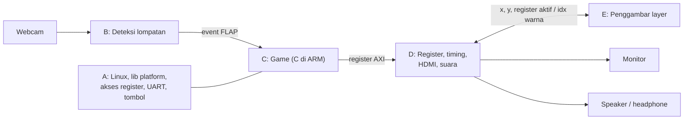

# Pembagian Tugas Jump-to-Flap (5 orang)

**Kondisi:** 5 anggota, waktu 2–3 minggu (jadwal dibuat 3 minggu = 15 hari kerja, H1–H15, dengan versi potong 2 minggu), board **Zybo Z7-10**, HDL **wajib VHDL** di **Vivado**, ditambah **efek suara hardware**.

| | Peran | File tugas | Nama anggota |
|---|---|---|---|
| A | Platform Linux & board | [tugasA.md](tugasA.md) | |
| B | Deteksi lompatan (computer vision) | [tugasB.md](tugasB.md) | |
| C | Software game + **koordinator** | [tugasC.md](tugasC.md) | |
| D | Kerangka akselerator grafis + suara (VHDL) | [tugasD.md](tugasD.md) | |
| E | Inti penggambar grafis (VHDL) | [tugasE.md](tugasE.md) | |

Peta besar sistem, arsitektur, dan rencana cadangan ada di [../PLAN-JUMP-TO-FLAP.md](../PLAN-JUMP-TO-FLAP.md).



---

## 1. Milestone bersama

| Kode | Kapan | Bukti selesai | Penanggung jawab |
|---|---|---|---|
| **M1** | H3 | Register map v1 dibekukan (bagian 3), webcam dan adaptor sudah ada, B mendeteksi penanda di laptop | C (koordinasi), D, E, B |
| **M2** | H4 | **Gate kamera:** Linux boot dari SD **dan** webcam terbaca di board? Jika tidak, pakai **Cadangan A** | A + C |
| **M3** | H5 | Pola uji VHDL tampil di monitor dari board. E: frame burung + pipa lulus simulasi `.ppm` | D, E |
| **M4** | H10 | Game dikendalikan **tombol** di board dan digambar renderer buatan sendiri | C, A, D, E |
| **M5** | H12 | Kontrol **lompatan** end-to-end. Efek suara berbunyi (bila sempat) | semua |
| **M6** | H15 | Uji akurasi dan latensi, laporan, video demo, perangkat demo siap | semua |

**Versi 2 minggu (H1–H10):**
- Efek suara dihapus.
- Teks hanya angka skor + 3 ikon status.
- Gate kamera dimajukan ke H3.
- M4 dimajukan ke H7, M5 ke H9, dan M6 ke H10.
- Autostart di SD menjadi opsional.

**Cadangan A** (bila M2 gagal):
- Laptop menjalankan detektor B dan mengirim byte `'F'` lewat USB-UART ke board.
- Game C berjalan **bare-metal** di ARM (Vitis), disiapkan oleh A.
- Renderer dan suara (D, E) tidak berubah sama sekali.

## 2. Jadwal gabungan per minggu

| Minggu | A | B | C | D | E |
|---|---|---|---|---|---|
| 1 | Beli webcam + adaptor; boot Linux dari SD (bersama C); uji webcam; **gate H4**; mulai lib platform | Prototipe deteksi di laptop; pilih penanda; kalibrasi + state machine; rekam video uji | Koordinasi + register map; bantu A bring-up; port logika game ke C dan uji di PC | Port timing + test pattern ke VHDL; testbench; cek pin XDC; **HDMI di board** | Paket tipe + layer background/lantai + pipa; sprite burung dari BRAM; testbench `.ppm` |
| 2 | Muat bitstream D di Linux; akses register (mmap/UIO); tombol, UART; atau Vitis bare-metal (Cadangan A) | Port detektor ke board atau mode pengirim UART; tuning ambang; tabel akurasi awal | Game loop sinkron vblank pakai lib A; game dengan tombol di board (**M4**) | Slave AXI-Lite + shadow/commit; block design PS7 + renderer E; export `.xsa` untuk A | Font angka + teks status; palet; mux prioritas; serah renderer ke D; bantu integrasi |
| 3 | Autostart dari SD; stabilitas daya/USB; kit demo | Integrasi detektor ↔ game (**M5**); uji akurasi + latensi final | Integrasi akhir, tuning ritme, trigger suara, laporan bagian software | **Modul efek suara** (I2C codec + I2S + nada); laporan utilisasi/timing | Bantu suara (generator nada) atau polish grafis; dokumentasi renderer; slide |

## 3. Kontrak antarmuka (wajib dipatuhi; perubahan lewat koordinator C)

### 3.1 Register map v1 (AXI-Lite, 32-bit, alamat dasar dari Address Editor Vivado, mis. `0x43C0_0000`)
**S** = register shadow. Nilainya baru dipakai renderer pada awal vblank setelah PS menulis `commit`.

| Offset | Nama | Bit | Keterangan |
|---|---|---|---|
| 0x00 | `CTRL` | [0] enable, [1] test_pattern, [2] commit (self-clear) | |
| 0x04 | `STATUS` | [0] in_vblank, [1] commit_pending, [31:16] frame_count | Hanya baca |
| 0x08 | `BIRD_POS` **S** | [9:0] x, [25:16] y | Piksel, kiri-atas sprite 32×32 |
| 0x0C | `BIRD_ATTR` **S** | [1:0] frame animasi, [2] visible, [3] flash | |
| 0x10–0x1C | `PIPE0..3` **S** | [10:0] x signed, [20:12] gap_y, [31] visible | C mengirim visible=0 bila pipa di luar −68..639 |
| 0x20 | `PIPE_CFG` **S** | [8:0] gap_h, [15:9] width | |
| 0x24 | `SCROLL_X` **S** | [9:0] | Pergeseran lantai |
| 0x28 | `SCORE` **S** | [15:0] BCD, 4 digit | PS mengonversi skor biner ke BCD sebelum menulis |
| 0x2C | `TEXT_ID` **S** | [3:0] | 0 kosong, 1 MENU, 2 KALIBRASI, 3 SIAP, 4 PAUSE, 5 GAME OVER, 6 KAMERA HILANG |
| 0x30 | `COUNTDOWN` **S** | [3:0] | 0 = tidak tampil |
| 0x34 | `IRQ` | [0] en_vblank, [1] ack | Opsional (UIO) |
| 0x38 | `SFX_TRIGGER` | [0] flap, [1] skor, [2] tabrak (self-clear) | Langsung, tanpa shadow |
| 0x3C | `AUDIO_CTRL` | [0] enable, [7:4] volume | |
| 0x40–0x7C | `PALETTE[0..15]` | [23:0] RGB888 | Indeks 0 = transparan untuk sprite |

Catatan:
- **`SCORE` dikirim sebagai BCD** (4 digit × 4 bit), supaya E tidak perlu pembagi di hardware.
- **Konstanta layar** (sama dengan `tools/game_model.py`): 640×480, lantai mulai y=416, burung 32×32 di x=160, tutup pipa tinggi 20 dan lebih lebar 4 px tiap sisi.

### 3.2 Antarmuka renderer (D ↔ E), paket VHDL `gfx_pkg.vhd`
- **Pemilik paket:** D yang membuat `gfx_pkg.vhd` (record `gfx_regs_t` berisi semua register aktif di atas) pada H2, lalu disetujui E.
- **Entity renderer milik E:** `renderer(clk, rst, x, y, de, regs : gfx_regs_t) → rgb(23:0), de_o`.
- **Latensi pipeline:** konstan `RENDER_LATENCY = 2` siklus. D menunda `hsync/vsync` sebanyak itu.
- **Pembaruan register:** E boleh berasumsi `regs` hanya berubah saat vblank.

### 3.3 Event flap (B → C)
- **Di board (Linux):** B menyediakan `detector_poll()` (thread terpisah) yang memanggil `game_flap_event(uint32_t t_ms)` milik C. Antriannya aman antarthread.
- **Cadangan A:** program laptop B mengirim byte `'F'` lewat serial **115200 8N1** untuk tiap lompatan sah. Status kamera dikirim sebagai `'L'` (penanda hilang) dan `'K'` (kembali terlihat).
- **Format bersama:** satu event = satu flap. Debounce dan cooldown adalah tanggung jawab B.

### 3.4 Lib platform (A → C), `sw/platform/platform.h`
```c
int  gfx_open(void);                         // mmap /dev/mem atau UIO, 0 = OK
void gfx_write(uint32_t offset, uint32_t v);
uint32_t gfx_read(uint32_t offset);
void gfx_commit(void);                       // tulis CTRL.commit
void gfx_wait_vblank(void);                  // blok sampai vblank berikutnya
uint32_t btn_read(void);                     // 4 tombol, bit per tombol
int  uart_read_flap(void);                   // -1 tidak ada, 'F'/'L'/'K' (Cadangan A)
uint32_t time_ms(void);
```
Semua fungsi juga punya versi **stub PC** (`platform_pc.c`), supaya C bisa menguji game di laptop sebelum board siap.

## 4. Aturan kerja
- **Repo dan branch:** satu repo git, satu branch per orang (`a-platform`, `b-detector`, `c-game`, `d-system`, `e-render`). Merge ke `main` oleh C setelah dicek bersama.
- **Folder milik masing-masing:** A `sw/platform/`, B `sw/detector/` + `tools/detector_*`, C `sw/game/` + `sw/config.ini`, D `hw/vhdl/system/` + `hw/constr/`, E `hw/vhdl/render/` + `assets/`. Mengubah folder orang lain harus seizin pemiliknya.
- **Sinkron harian 15 menit:** tiap orang menyampaikan kemarin mengerjakan apa, hari ini apa, dan terhambat apa. Hambatan lebih dari 1 hari langsung dibawa ke C.
- **Bukti:** setiap selesai satu langkah, simpan foto/screenshot/log ke `docs/bukti/<huruf>/` untuk laporan.
- **Vivado:** satu versi untuk semua, catat di [../../hw/README-VIVADO.md](../../hw/README-VIVADO.md).
- **Laporan:** tiap orang menulis bab bagiannya. C menggabungkan.
